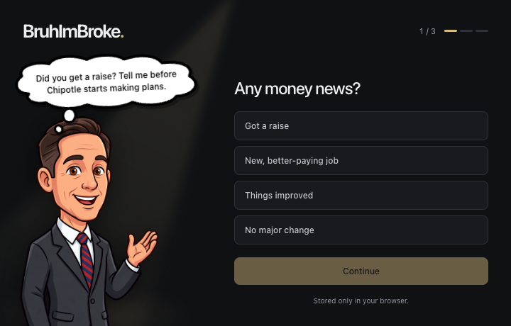
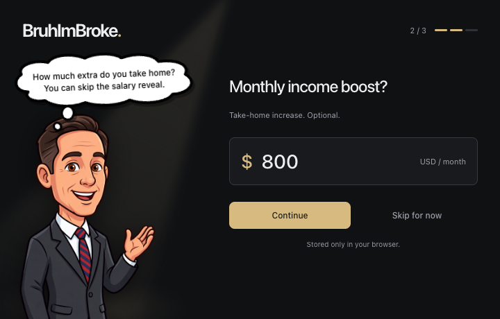
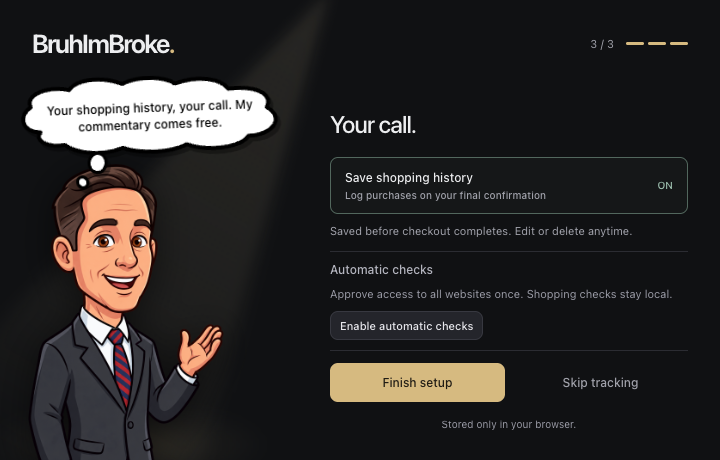
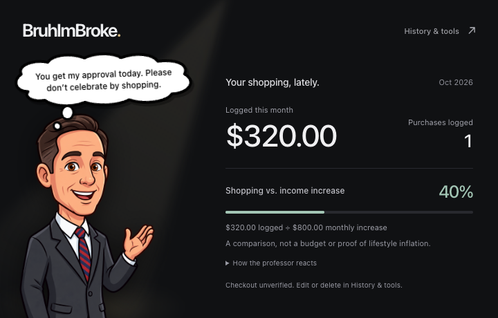
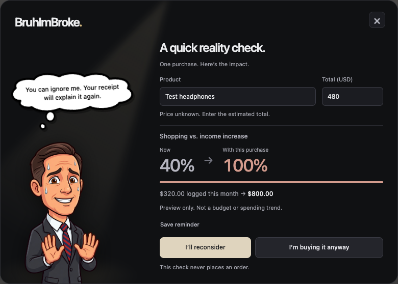
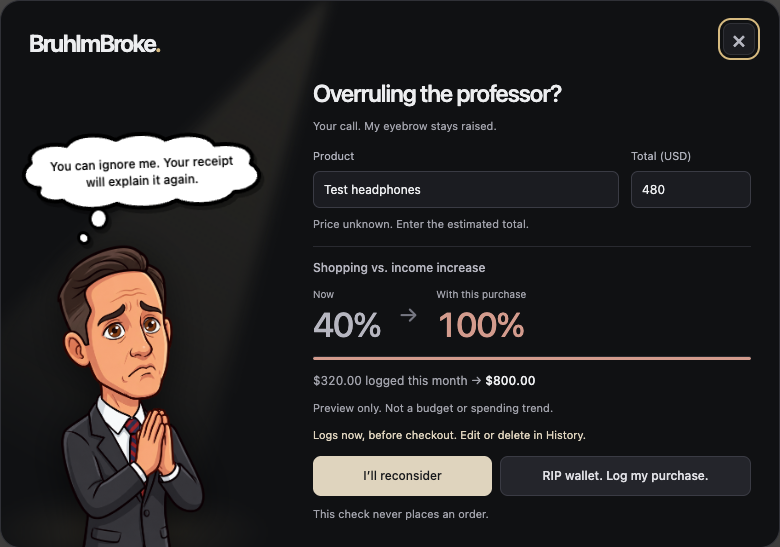
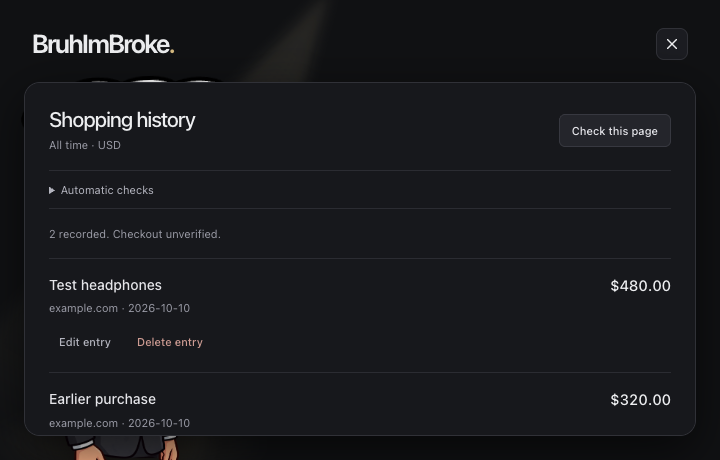
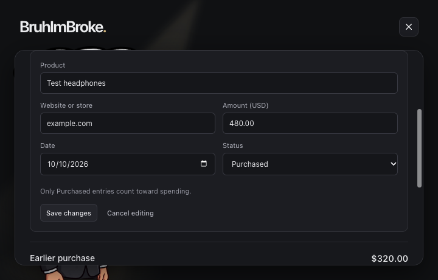

# BruhImBroke

Your wallet’s last line of defense against yourself.

I built a Chrome extension for my HON 410 class. This is to add friction to impulse purchases and general spending. The whole point is that if I get a raise, I shouldn’t immediately increase my spending by the same amount and cancel out the chance to build wealth.

Basically, making more money shouldn’t just mean giving more money to Amazon and Chipotle.

Instead of another budgeting dashboard I’ll forget to check, a slightly judgmental professor shows up when I try to buy something. He gives me a second to think, shows what the purchase would do to my spending, and makes a comment I probably didn’t ask for.

You can still buy it. That’s the point: a pause, not a ban on spending.

## Try it locally

You’ll need Chrome, Node.js, and npm. From this project’s folder:

```bash
npm install
npm run build
```

1. Open `chrome://extensions` in Chrome.
2. Turn on **Developer mode** in the top right.
3. Click **Load unpacked** and select this project’s `.output/chrome-mv3` folder.
4. Pin BruhImBroke from Chrome’s extensions menu, then click its icon.

On macOS, press **Cmd + Shift + .** in the folder picker if `.output` is hidden.

After code changes, run `npm run build` again, reload the extension at `chrome://extensions`, and refresh any shopping tabs that were already open. Reloading alone does not rebuild the code.

## How it works, step by step

These are screenshots of the current extension using fictional local test data. The shopping screens use a test storefront, not a real order. There’s no built-in demo mode yet.

### 1. Tell the professor what changed

Got a raise, started a better-paying job, or just doing better financially? Pick the option that fits. **No major change** works too. We’re not connecting to your bank.



### 2. Enter the extra monthly income, if you want

This is your monthly **take-home increase**, not your whole salary. If you now take home $800 more each month, enter `800`. You can also skip it and still use the shopping checks and history.



### 3. Choose history and automatic checks

Choose whether to save shopping history. Click **Enable automatic checks** if you want the extension to watch for shopping buttons across websites. Chrome asks for website access once, rather than making you approve every store.

That permission is optional. Without it, **History & tools → Check this page** is the manual fallback. Amazon.com also has built-in checks.

If the popup closes during the permission prompt, just reopen it. Your step and answers are saved. Click **Finish setup** when you’re ready.



### 4. See where your shopping stands

The main screen shows what you’ve logged this month, how many purchases you’ve logged, and how that total compares with your extra monthly income. The professor changes expressions as the percentage goes up.

In this example, $320 of logged shopping compared with an $800 monthly income increase is **40%**.



### 5. Try to buy something

Click a recognized **Add to Cart**, **Add to Bag**, **Buy Now**, or checkout button on a supported shopping page. The professor interrupts that click and shows what the purchase would do to the percentage.

Check the product and total. Amazon prices can be detected, but they’re still estimates. Other stores currently need a manually entered USD total.

Here, a potential $480 purchase would take the example from $320 to $800, or **40% to 100%**. Nothing has been logged yet.



Below 50%, you get the good-purchase professor. At 50% or above, you get the bad-purchase reaction. These are joke thresholds, not a verdict on whether you can afford something.

### 6. Reconsider, or overrule him

**I’ll reconsider**, the **X**, or Escape closes the interruption without carrying out the shopping click.

If you choose **I’m buying it anyway**, you get one last confirmation. For a higher-impact purchase, the professor switches to his reconsider expression.



With tracking on, **RIP wallet. Log my purchase.** records the purchase immediately. We assume you’re going through with it. The extension does **not** verify that checkout finished or place the order for you.

Then click the same store button again within 30 seconds. That one click goes through without another interruption. With tracking off, the final button lets you proceed without logging anything.

### 7. Fix anything in history

Open **History & tools** to see what you’ve logged. If you changed your mind after confirming, delete the entry. If the amount or product was wrong, edit it. The dashboard updates with those changes.



You can correct the product, store, amount, date, and status right there. **Save reminder** entries stay under **To confirm** and don’t count as spending until confirmed.



Use the **X** to return to the dashboard. **Clear saved shopping data** removes purchases and reminders after confirmation, without resetting onboarding. Don’t log both individual items and the cart containing those same items, or they’ll count twice.

## What the percentage actually means

```text
This month’s logged shopping ÷ monthly take-home income increase × 100

$320 ÷ $800 × 100 = 40%
```

At 100%, the shopping you’ve logged this month equals the extra income you entered. It doesn’t mean your bank balance is zero or that you’ve spent your whole salary.

| Dashboard percentage | Professor |
| --- | --- |
| Below 50% | Happy |
| 50% to below 100% | Questionable |
| 100% or more | Sad |

Without an income increase, or with tracking off, he stays neutral. The percentage can go above 100%, even though the visual bar stops at full width.

The goal is to make lifestyle inflation harder to ignore. But this version compares **total logged shopping** with your income increase. It doesn’t compare spending before and after your raise, so it can’t prove how much of that raise you’ve actually spent on lifestyle upgrades. It’s a reality check, not a full financial picture.

## Privacy and current limits

- Everything is local to your Chrome profile: preferences, unfinished onboarding, purchases, reminders, and paused sites. No account, backend, or bank connection.
- It doesn’t read payment details, submit orders, or secretly confirm purchases. Logging happens when you explicitly choose the final confirmation.
- Amazon.com is the main target. Other stores use common button wording and shopping-page context, so some sites or layouts will be missed. Use **Check this page** when that happens.
- Website access enables local shopping checks. You can pause a specific site in **History & tools → Automatic checks**, or revoke access through Chrome’s extension settings.
- Prices are USD estimates. Check quantity, discounts, tax, and shipping yourself. Missing prices need manual entry.

## Development

Built with **WXT, React, TypeScript, CSS, Chrome local storage, and Manifest V3**. No server required.

```bash
npm run dev      # Start development mode and open Chrome
npm run compile  # TypeScript checks
npm test         # Build and run the test suite
```

Development mode uses `.output/chrome-mv3-dev`; keep the dev server running. The regular build uses `.output/chrome-mv3`.

For detection details, storage keys, and testing limitations, see the [technical notes](docs/technical-notes.md) and [retailer notes](docs/retailer-notes.md).
